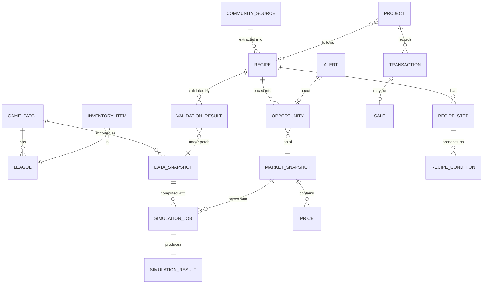

# Database schema

Game data is **not** stored in SQL. Each patch is an immutable JSON snapshot under `data/snapshots/<game version>/`, with a `manifest.json` recording the source URL, SHA-256 and import time for each file. SQLite holds user and market state. Any calculation stores the `game_version` and market snapshot id it used, so it can be reproduced later.

## Implemented (migration `001_initial.sql`)

| Table | Purpose |
|---|---|
| `schema_migrations` | Applied migration files |
| `settings` | Key/value settings (league, …) |
| `version_checks` | History of game-data and league version observations |
| `market_snapshots` | One row per fetch, with the raw payload kept for provenance and backtesting |
| `prices` | Normalised rows per snapshot (`is_listing_price = 1`: asking price, not a sale) |
| `price_overrides` | Your manual prices; these take priority over fetched ones |
| `inventory` | Currency and materials per league (UI comes in Phase 10) |
| `saved_plans` | (`002_saved_plans.sql`) Crafts saved from the Route Planner: wanted mods, your sale price, cheapest route and its expected cost when saved (ROI board) |

## Planned entity relationship diagram

Planned tables by phase:
- **Phase 4:** `simulation_jobs`, `simulation_results`.
- **Phase 6:** `community_sources`, `source_evidence`, `recipes`, `recipe_steps`, `recipe_conditions`, `recipe_outcomes`, `validation_results`.
- **Phase 9:** `opportunities`, `comparable_items`, `item_valuations`, `build_demand_indicators`.
- **Phase 10:** `projects`, `transactions`, `sales`, `pnl_records`.
- **Phase 11:** `alerts`, `update_history`.

## Migrations

These are numbered SQL files in `backend/poeci/storage/migrations/`, applied automatically on start and recorded in `schema_migrations`. A file is never edited after it has shipped; changes go in a new file.

## Indexing

- `(source, league, category, fetched_at)` on snapshots.
- `name` on prices.
- `(kind, checked_at)` on version checks.

New indexes get added when a query shows up in profiling.

## Backups

The database is a single file: `data/poeci.sqlite3`. `scripts\backup.ps1` copies it with a timestamp. Snapshots can always be downloaded again but are kept for reproducibility.
